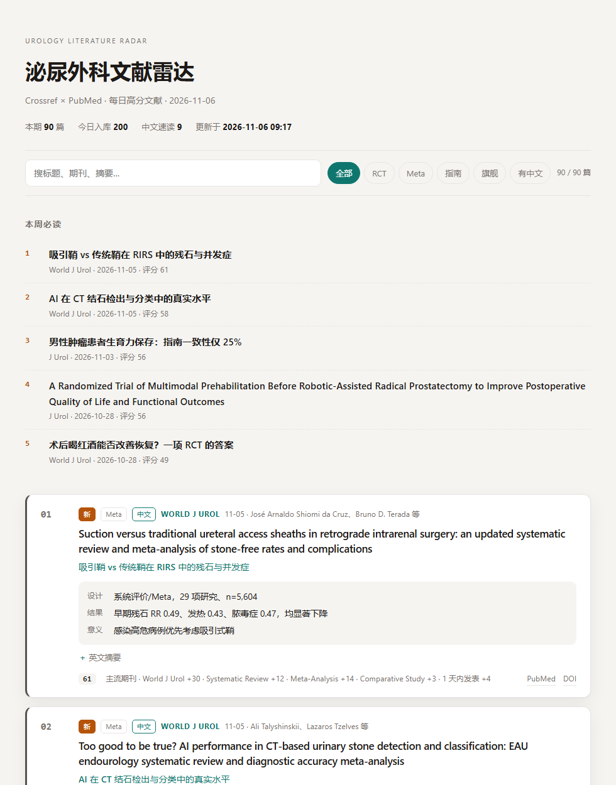

# 泌尿外科文献雷达

**在线地址：<https://muguchenshanzhang-del.github.io/uro-radar/>**（每天北京时间 07:30 自动更新）

每天早上自动生成一份**只属于泌尿外科**的高分文献清单，打开网页就能看。
不用服务器，不用数据库，不装任何第三方包 —— 跑在 GitHub Actions 上，零成本。



## 它做什么

- 从 **20 本泌尿外科期刊**抓最近 10 天的新文章：Crossref 保证「快」（上线当天就有），PubMed 保证「全」（摘要、文献类型、MeSH）
- 按 **期刊层级 + 研究类型 + 你的兴趣词 + 新鲜度**打分排序；病例报告、社论、勘误自动降权
- 给分数最高的 30 篇生成**中文三行速读**：设计 / 结果 / 意义
- 输出一个自包含的静态网页，手机可看，能按 RCT / Meta / 指南 / 旗舰筛选，能搜关键词

为什么不是「按影响因子排」：顶刊一天也能发十条 case report 和社论。只按 IF 排，你每天看到的都是噪声。

## 五分钟部署（零服务器）

1. 新建一个仓库，把这个目录推上去（私有库也行）
2. **Settings → Actions → General → Workflow permissions → 选 `Read and write permissions`**
   （不选的话，定时任务无法把 `data/state.json` 提交回去，第二天会重复推同样的文献）
3. **Settings → Secrets and variables → Actions → New repository secret**，名字 `LLM_API_KEY`，值填你的 key
   （DeepSeek / Kimi / 通义 / OpenAI 任意 OpenAI 兼容接口都行；不填也能跑，只是没有中文速读）
4. **Settings → Pages → Build and deployment → Source 选 `GitHub Actions`**
5. **Actions → 每日文献雷达 → Run workflow**，等两三分钟
6. 打开 `https://<你的用户名>.github.io/<仓库名>/`

之后每天北京时间 07:30 自动更新。实际会晚几分钟到半小时 —— GitHub 的 cron 就是这样的。

## 本地跑

```bash
python main.py check      # 先核对期刊池：Crossref 和 PubMed 各能抓到多少
python main.py build      # 抓取 + 打分 + 生成 public/index.html
```

需要 Python 3.11+，**零第三方依赖**（只用标准库）。生成完直接双击 `public/index.html` 就能看。

加 `--no-llm` 可以跳过中文速读，只测抓取和排序。

## 怎么改

所有配置都在 [`config.toml`](config.toml)：

| 字段 | 说明 |
|---|---|
| `[[journals]]` | 期刊池。`issn` 给 Crossref，`abbr` 必须是 PubMed 的 NLM 缩写 |
| `tier` | 5 旗舰 / 4 一线 / 3 主流 / 2 补充，只影响排序权重 |
| `group` | 页面上的分类，可自己改成 肿瘤 / 结石 / 尿控… |
| `interests` | 兴趣词，命中标题或摘要加分 |
| `[llm]` | 接口地址、模型、每天最多生成多少篇（控成本） |

**加期刊时**：`abbr` 去 PubMed 搜这本刊，刊名下面那行缩写就是（例：`Eur Urol`）；`issn` 用期刊官网或 Crossref 的。加完一定要跑 `python main.py check`，两边都非 0 才算对。

## 没有 API key？也能有中文速读

两条路：

1. **关掉**：`config.toml` 里 `[llm] enabled = false`
2. **让 agent 写**：把 `public/papers.json` 里 `zh_title` 为 `null` 的条目丢给任意模型，让它按 [`data/demo-digest.json`](data/demo-digest.json) 的格式返回，然后

   ```bash
   python main.py apply 你的文件.json
   ```

   这条对 Claude Code / Codex 这类工具特别顺 —— 跑它的模型本身就是那个 LLM，不用另外配 key。

## 评分是怎么算的

```
score = tier × 10
      + 研究类型加减分
      + 兴趣词命中（每个 +2，最多 +10）
      + 新鲜度（3 天内发表 +4）
      + 被引（≥5 次才计，封顶 +8）
      − 无摘要 12
```

研究类型：RCT +16、指南 +16、Meta 分析 +14、系统评价 +12、多中心 +8；
综述 −2、病例报告 −14、社论/评论 −16、勘误/撤稿 −40。

每张卡片底部那行就是它的分数构成，一眼能看出「这篇为什么排在这」。

## 已知的坑（都实测踩过）

1. **别用期刊 RSS**。LWW 系的 CDN 会拦爬虫，部分 Springer 的 `search.rss` 干脆是坏 XML。所以这里一律走 PubMed `[ta]` 和 Crossref 的 ISSN 接口。
2. **PubMed 收录滞后**。文章 online-first 到进 PubMed 常差 3–10 天。所以 Crossref 当「快」源、PubMed 当「全」源，两边按 DOI 合并，摘要取长的那个。
3. **Crossref 条目没有研究类型**。新上线那几天只能用标题兜底（`randomized` / `meta-analysis` / `case report`），等 PubMed 收录后库里会自动补上真实类型。
4. **Actions 的 cron 不准时**。整点前后拥堵，晚 5–30 分钟是常态。要准点得自己上服务器（Cloudflare Workers Cron 或一台 VPS）。
5. **`data/state.json` 必须提交**。里面只有「见过的 DOI」和「已生成的中文速读」，不提交就会重复推、重复调模型花钱。摘要原文存在本地 `data/radar.db`（已 gitignore），所以公开仓库里没有出版社的正文内容 —— 这也是这里不提交整个数据库的原因。

## 目录

```
config.toml            期刊池、评分权重、LLM 配置
main.py                入口
radar/
  sources.py           Crossref + PubMed 抓取，按 DOI 合并
  score.py             打分逻辑
  digest.py            中文速读（OpenAI 兼容接口）
  notify.py            推送：企业微信 / Server酱 / Bark / 邮件
  store.py             SQLite：去重 + 速读缓存 + 推送标记
  render.py            生成静态页面
  cli.py               命令行
data/state.json       见过哪些 DOI + 已生成的中文速读（会被 Actions 提交回仓库）
data/radar.db         本地抓取缓存，含摘要原文，不进仓库
public/index.html     生成物
.github/workflows/daily.yml
```

## 推送到手机

四个通道写好了，**配一个就能用**，配多个也不冲突。都不配就只出网页。

### 企业微信群机器人（推荐）

免费、不限量、卡片式，手机上装个企业微信就行（个人也能注册企业）。

1. 企业微信 → 建一个只有自己的群（或随便找个群）
2. 群右上角 → 群机器人 → 添加 → 复制 Webhook 地址
3. 仓库 **Settings → Secrets and variables → Actions** → 新建 `WECOM_WEBHOOK`，粘贴地址
4. Actions → 每日文献雷达 → Run workflow → 模式选 **test-push**，十几秒后群里就会收到一条测试消息
5. 再跑一次 **build**，当天最高分的 8 篇会推过来

以后每天 07:30 自动推当天最高分的 8 篇，带中文结论和原文链接。

### 其他三个通道

| 通道 | 怎么拿 | Secret |
|---|---|---|
| Server酱（进个人微信） | [sct.ftqq.com](https://sct.ftqq.com) 微信扫码，拿 SendKey | `SERVERCHAN_KEY` |
| Bark（iPhone 锁屏） | App 里复制设备地址，形如 `https://api.day.app/xxxxx` | `BARK_URL` |
| 邮件 | 任意 SMTP，QQ/163 要用「授权码」不是登录密码 | `SMTP_HOST` `SMTP_PORT` `SMTP_USER` `SMTP_PASS` `MAIL_TO` |

推送逻辑在 [`radar/notify.py`](radar/notify.py)：写进 `state.json` 的 `pushed` 字段，同一篇不会推第二遍。想先看效果不发出去：

```bash
python main.py notify --dry-run
```

## 还能加什么

- **指南更新单独提醒**：`pubtype` 里有 `Practice Guideline` 时另发一条，别混在日常流里
- **按亚专科拆页**：`group` 已经有了，`render.py` 里循环生成几个子页面即可
